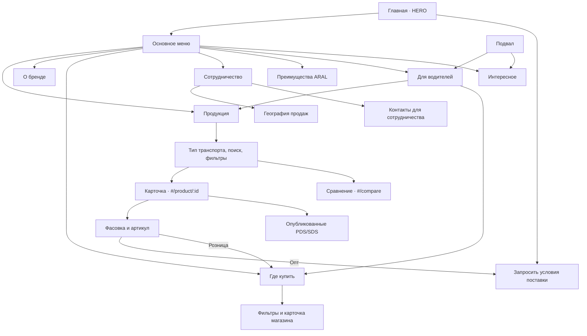

# ARAL R12

R12 состоит из семи статических HTML-документов. Отдельная главная с HERO открывается по логотипу. «О бренде» и «Интересное» обслуживает один HTML с собственными хешами. У каталога отдельный клиентский роутер.

| Раздел | Путь от корня проекта |
| --- | --- |
| Главная | `design/hero/prototypes/hero-4s-k-views/ARAL_home_employer_feedback_r12_preview.html` |
| О бренде | `index-employer-feedback-r12-preview.html#company` |
| Продукция | `pages/products-employer-feedback-r12-preview.html#/catalog` |
| Для водителей | `pages/drivers-employer-feedback-r12-preview.html` |
| Сотрудничество | `pages/partners-employer-feedback-r12-preview.html` |
| Преимущества ARAL | `pages/advantages-employer-feedback-r12-preview.html` |
| Интересное | `index-employer-feedback-r12-preview.html#interesting` |
| Где купить | `pages/contacts-employer-feedback-r12-preview.html#contacts-stores` |

## Данные

Каталог R12 читает встроенный массив из 17 продуктов и 47 SKU. Интерфейс показывает 16 карточек при сброшенных фильтрах. Охлаждающая жидкость скрывается существующим правилом R12. Отдельный `catalog.json` содержит 17 продуктов и 47 SKU и проверяется скриптом `scripts/validate_catalog.py`. Автоматической синхронизации с HTML нет. Серверная база и API отсутствуют. Сравнение до четырёх продуктов сохраняется в `localStorage`. На узком экране пользователь выбирает два из них, а при печати видит все добавленные позиции. Списки магазинов и география партнёров встроены в соответствующие HTML.

При переходе из карточки на страницу контактов передаются ID товара и SKU. Страница сверяет пару по `catalog.json` и показывает название с фасовкой. Для опта можно дополнить черновик количеством упаковок и городом, скопировать его или открыть в WhatsApp. Переход к рознице открывает поиск магазинов с выбранной фасовкой в заголовке.

## Оформление

`assets/aral-r12-design.css` подключён ко всем семи документам R12. Он задаёт общую палитру, гарнитуру и правила оформления поверх компонентных стилей страниц. Локальный файл Nunito и лицензия находятся в `assets/fonts/`. Для каталога размеры строк, фильтры, сравнение и технические обозначения проверяются отдельно от редакционных заголовков. Для справочных блоков используются открытые ряды с разделителями. У интерактивных карточек каталога сохранена граница и обратная связь при наведении и фокусе.

## Локальный запуск

Для работы с исходниками из папки `ARAL-main` запустите `python -m http.server 8000` и откройте путь к главной R12 из таблицы. Для проверки релиза используйте команды сборки из [README](../README.md). В артефакте корневой `index.html` открывает главную R12, а прежние адреса разделов перенаправляются с сохранением хеша.
